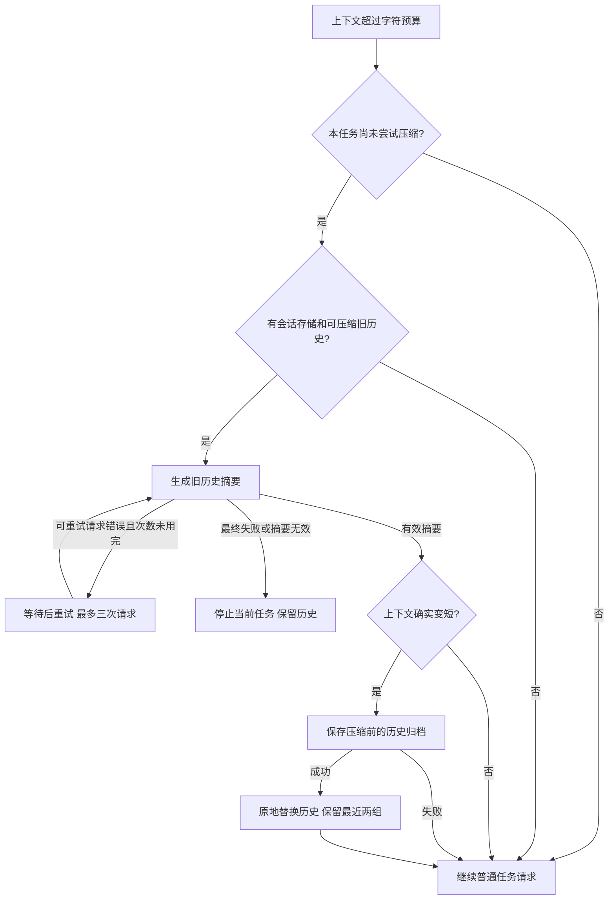
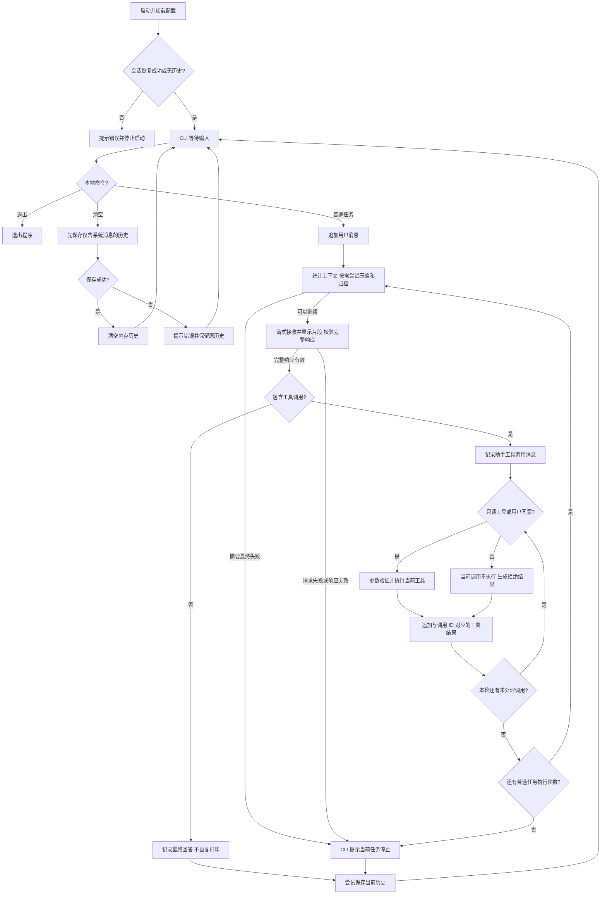
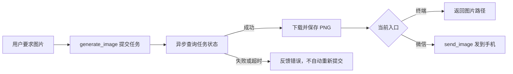

# ZipClaw

一个参考 pi 风格分层思路、使用 Python 从零实现的学习型编程智能体。

当前已完成编程智能体的基础闭环：**输入任务 → 模型选择工具 → 确认操作 → 执行工具 → 回传结果 → 模型回答**。支持终端连续对话、六个基础工具及可选网页搜索和图片生成、正文与推理文本流式显示、按工作区保存与恢复会话，以及上下文统计、历史摘要压缩、摘要请求有限重试和压缩前归档。项目正在从“功能跑通”进入“稳定可用”的阶段。

长期目标是逐步实现能够理解项目、修改代码、运行测试并根据结果修复问题的编程智能体。这里不是 pi-mono 的直接移植，也不是已经具备完整能力的 OpenClaw。

## 当前能力

- 个人微信 ClawBot 入口：扫码登录、私聊任务、图片回传、输入状态、任务排队，
  支持操作确认、取消、清空及可配置的完全访问。使用见 [微信接入教程](docs/wechat.md)。
  终端和微信共用六个基础工具，以及可选的 web_search、generate_image；微信额外提供 send_image，真实收发效果需在手机确认。

- 在终端持续聊天，保留对话与工具调用历史；重新启动时恢复同一工作区的已保存会话。
- 通过 OpenAI 兼容的 Chat Completions 接口调用模型，允许配置服务地址和模型名称。
- 使用 Pydantic 定义工具参数、生成 JSON 参数结构，并在执行前验证参数。
- 支持一次模型回复中的多个工具调用，当前按顺序执行。
- 保留模型返回的 `reasoning_content` 字段，在后续消息中回传。
- 使用 `list_dir` 查看目录，使用 `read_file` 按起始行、行数和字符上限读取文本文件。
- 使用 `write_file` 新建文件，不覆盖已有文件。
- 使用 `edit_file` 精确替换已有文件的一处文本，匹配不唯一时拒绝修改。
- 使用 `grep` 搜索文件内容，返回相对路径、行号和匹配行。
- 使用 `run_command` 执行程序，返回正常输出、错误输出和退出码，支持超时与输出截断。
- 配置独立的 `TAVILY_API_KEY` 后，使用 `web_search` 获取网页标题、来源链接和摘要；未配置时不注册该工具。
- 配置独立的 `MODELSCOPE_API_KEY` 后，使用 `generate_image` 生成一张 PNG，或根据公开参考图链接修改图片；只有最终图片，不额外生成绘图脚本。微信中继续调用 `send_image` 发到手机。
- 正文逐段显示；模型服务提供 `reasoning_content` 时，可以逐段显示推理文本。
- 工具日志与推理显示分别由开关控制；纯空白正文不会提前打印空的回答标题。
- 读取、列目录和本地文本搜索直接执行；新建、编辑、运行命令、联网搜索、生图等其它调用逐个询问，默认拒绝。
- 统计消息历史和工具说明的 JSON 字符数，超过默认 60000 字符预算时尝试压缩旧历史。
- 保留最近两组用户任务；摘要确实缩短上下文且归档成功后，才替换旧记录。
- 摘要请求对标记为可重试的错误最多尝试三次；普通流式任务不自动重试。
- 工具说明、模型提示词和项目自定义反馈使用中文。
- 文件工具检查工作区路径边界；命令执行工具仅设置启动目录，不提供文件访问隔离。
- 将部分工具执行异常转换成工具结果，让模型有机会调整参数。
- 每个用户任务默认最多执行 10 轮模型—工具循环；额外的摘要请求及其重试不计入轮数。
- 为连接失败、超时、认证失败等常见请求错误提供中文提示，任务停止后仍可继续输入。
- 在适配层检查工具参数 JSON、调用 ID、名称和部分回复字段；无效响应不进入历史，本轮工具不执行。
- 已有 `unittest` 工具、核心循环、会话存储、模型适配器和 CLI 测试文件；部分旧测试待适配最新交互。

配置兼容接口不代表所有服务、模型与推理模式都已经验证兼容；当前适配器仍使用同一套消息格式。

## 当前进度与下次继续的位置（2026-10-12）

已完成模型适配层、智能体循环、工具注册表和终端应用的最小实现。六个基础工具已注册，可选网页搜索和图片生成已接入终端和微信；可以完成简单的文件查看、代码修改与运行验证任务。此前已有 `git --version` 和 `calculator.py` 简单修复任务的成功记录。

最近完成的功能：

- 新增 `web_search`：调用 Tavily 的基础搜索接口，最多返回五条标题、链接和摘要；有独立密钥才启用，失败不自动重试。该工具不是网页全文读取工具。
- 新增 `generate_image`：按 ModelScope 异步接口提交任务、查询状态并保存 PNG；默认模型为 `Qwen/Qwen-Image-2.1-Turbo`，不下载模型权重。覆盖、越界、无效图片和失败重复提交都有相应限制，真实生图效果仍需有效 Token 验证。
- 核心循环支持多轮和批量工具调用，并把工具结果与调用 ID 对应起来。
- 系统提示词要求执行 Python 时优先检查目标工作区的虚拟环境；这是一条模型指令，工具没有自动替换解释器。
- `read_file` 支持分页和返回正文字符限制；操作确认与显示开关已经接入核心循环。
- `SessionStore` 保存当前消息列表到 JSON，支持启动恢复、工作区隔离和 `/clear` 同步保存。压缩前另外保存独立归档。
- 上下文管理已接入循环：默认字符预算 60000，保留最近两组任务，每个用户任务最多进入一次压缩流程。
- SDK 自动重试关闭，超时配置为 120 秒；摘要请求另外实现有限重试。摘要最终失败会停止当前任务并保留历史。
- 同一响应中的工具调用全部解析成功后才交给核心循环；第二个调用解析失败时，这一轮的第一个调用也不会执行。
- `BaseLLM` 提供事件接口，`OpenAILLM.stream()` 实际接收流式数据；核心循环即时显示片段，完成响应校验后才保存消息或执行工具。
- 数据模型文件现为 `llm/llm_types.py`；CLI 当前读取 `USTC_API_KEY`、`USTC_MODEL` 和 `USTC_BASE_URL`。

现有测试文件静态统计包含 **136 个测试方法**：工具层 78 个、核心循环 20 个、会话存储 3 个、普通模型适配器 18 个、CLI 17 个。这个数字是源码中的测试方法数量，不是最新通过数量。

近期聊天记录已经展示了历史压缩与归档、正文和推理文本流式输出；操作确认也已在源码中接入。测试代码尚未全部适配最新功能，例如 CLI 测试仍使用旧的 `OPENAI_*` 配置和非流式模拟，部分循环测试没有模拟操作确认。本次注释与文档更新不新增或修改测试，也未重新运行完整测试集。

当前优先继续完善 coding agent 的功能，再按需要同步自动化测试。后续重点包括任务中断后的恢复、编辑原子保存和变更检查、模型专用参数配置，以及事件显示与核心逻辑的进一步分离。继续使用清楚的中间变量、普通循环和中文注释，按小步骤学习。

## 快速开始

以下命令以 Windows PowerShell 为例。推荐先把项目安装为 `zipclaw` 命令，以后在任意目标项目目录启动。

### 1. 准备环境

需要 uv、Python 3.12 或更新版本，以及可用的模型 API Key。使用的模型需要支持工具调用。

安装一次命令（路径替换为你自己的 ZipClaw 源码目录）：

```powershell
uv tool install --editable "C:\Users\28657\Desktop\ZipClaw"
uv tool update-shell
```

- `uv tool install` 为工具管理独立环境、安装依赖并生成命令，不使用项目的 `.venv`，也不是发布或上传项目。
- `--editable` 让命令使用这份本地源码，修改 Python 文件后无需重新安装。
- `uv tool update-shell` 按需更新 PATH，让终端能找到命令。首次设置后重新打开终端。

项目已经配置 setuptools 构建后端、`src` 包发现及命令入口：

```toml
[project.scripts]
zipclaw = "zipclaw.cli:entrypoint"
```

执行 `zipclaw` 会调用同步函数 `entrypoint()`，由它通过 `asyncio.run(main())` 启动异步 CLI。

### 2. 配置环境变量

在项目根目录创建 `.env` 文件，填写以下配置（全部示例值都需要按自己的服务替换）：

```dotenv
USTC_API_KEY=your_api_key_here
USTC_BASE_URL=https://your-provider.example/v1
USTC_MODEL=your_tool_capable_model_id

# 可选：填写独立的 Tavily 密钥后启用网页搜索；不使用时留空。
TAVILY_API_KEY=

# 可选：填写独立的 ModelScope Token 后启用图片生成；不使用时留空。
MODELSCOPE_API_KEY=
MODELSCOPE_IMAGE_MODEL=Qwen/Qwen-Image-2.1-Turbo

ZIPCLAW_SHOW_TOOL_LOGS=false
ZIPCLAW_SHOW_REASONING=true
ZIPCLAW_MAX_STEPS=10
ZIPCLAW_CONTEXT_CHAR_BUDGET=60000
```

| 变量 | 说明 |
| --- | --- |
| `USTC_API_KEY` | 必填，模型服务的 API Key |
| `USTC_MODEL` | 必填，该服务实际支持的模型 ID |
| `USTC_BASE_URL` | 第三方兼容服务需要填写；省略时使用 SDK 默认地址 |
| `TAVILY_API_KEY` | 可选，独立搜索密钥；留空不注册 `web_search`，不能默认复用 USTC 密钥 |
| `MODELSCOPE_API_KEY` | 可选，ModelScope Token；留空不注册 `generate_image`，与聊天及搜索密钥分开 |
| `MODELSCOPE_IMAGE_MODEL` | 可选，ModelScope 图片模型 ID；默认 `Qwen/Qwen-Image-2.1-Turbo`，启用生图时不能留空 |

`USTC_*` 是当前 CLI 实际读取的变量名，不代表必须使用某个固定服务。请填写与你所用接口对应的地址、模型 ID 和密钥。旧的 `OPENAI_*` 名称目前不会被这段 CLI 自动读取。

思考模式由 `ZIPCLAW_THINKING_MODE` 配置，同时作用于普通摘要请求和流式聊天请求。允许以下三个值：

- `default`：不添加 `thinking` 扩展字段，使用服务端默认行为，不代表关闭思考。
- `enabled`：发送 `{"thinking": {"type": "enabled"}}`。
- `disabled`：发送 `{"thinking": {"type": "disabled"}}`。

后两个值只适用于明确支持这种格式的接口；它不是所有兼容服务的通用参数。显示推理文本由 `ZIPCLAW_SHOW_REASONING` 单独控制，两种请求均未显式设置 `reasoning_effort`。

CLI 使用 `load_dotenv()` 加载配置。已有的进程环境变量通常会优先于 `.env`，修改文件后如果配置没有生效，也要检查终端里是否设置了同名变量。

随后由 `config.py` 的 `load_config()` 统一读取和检查配置。布尔值填写 `true` 或 `false`，不区分大小写；轮数和字符预算必须是正整数。缺少必填项或填写错误时，CLI 显示中文配置错误并停止启动。可参考不含真实密钥的 `.env.example`。

`.env` 已被 `.gitignore` 忽略。不要把真实 Key 写进 README、源码或提交记录。

### 3. 启动

安装完成后，在想让智能体操作的目录执行：

```powershell
zipclaw
```

直接在终端输入 `zipclaw` 即可。在 Windows 文件资源管理器的地址栏，也可以输入 `cmd /k zipclaw`，打开命令行并在程序退出后保留窗口。

### 4. 试一次工具调用

```text
> 先查看项目根目录，再读取 pyproject.toml，告诉我用了哪些依赖。

ZipClaw > ……

> 再看看 src/zipclaw/core 目录。

ZipClaw > ……
```

终端显示轮次、上下文统计，并逐段显示正文。默认隐藏工具日志；开启后，参数预览最多显示前 300 个字符，结果预览最多显示前 500 个字符。预览截断只影响终端展示，工具本身的分页或输出限制则会影响实际返回内容。

写文件、编辑、运行命令、联网搜索和生图时，会先展示完整参数并询问是否允许执行，直接回车默认拒绝。确认提示不受工具日志开关影响。

工具结果进入上下文后，模型仍可能给出总结。想看原文时可以明确要求“逐字返回原文，不要概括”；最终展示方式仍由模型响应决定。

### 显示开关与执行参数

CLI 从 `.env` 或进程环境变量读取下面四个设置，经 `config.py` 校验后传给 `AgentLoop`。修改配置后重新启动生效，目前没有对应的聊天命令或命令行选项。直接在 Python 中创建 `AgentLoop` 时，仍可以显式传入这些参数。

| 环境变量 | 对应参数 |
| --- | --- |
| `ZIPCLAW_SHOW_TOOL_LOGS` | `show_tool_logs` |
| `ZIPCLAW_SHOW_REASONING` | `show_reasoning` |
| `ZIPCLAW_MAX_STEPS` | `max_steps` |
| `ZIPCLAW_CONTEXT_CHAR_BUDGET` | `context_char_budget` |

| 参数 | 当前默认值 | 作用 |
| --- | --- | --- |
| `max_steps` | `10` | 普通任务最多执行多少轮模型—工具循环 |
| `show_tool_logs` | `False` | 是否显示工具名称、参数预览和结果预览 |
| `show_reasoning` | `True` | 是否显示服务端实际返回的推理文本 |
| `context_char_budget` | `60000` | 超过多少个 JSON 字符后尝试压缩历史 |
| `session_store` | `None`，CLI 会传入实例 | 用于压缩前归档；未传入时跳过历史压缩 |

`show_reasoning` 只控制显示，不开启模型思考，也不调整思考强度。关闭它时，已返回的推理字段仍会收集并存入历史。工具日志开关不关闭工具执行、操作确认、轮次提示或上下文提示。

正文刚开始只有空格或换行时，核心循环先暂存，不打印空的 `ZipClaw >`。收到非空白文字后连同原始空白一起显示；正文开始后的空格和代码缩进不会被删除。

### 修改源码后如何生效

可编辑安装后，修改 `.py` 文件，只需在正在运行的 ZipClaw 中输入 `exit`，然后回到 PowerShell 再执行 `zipclaw`。新进程会加载更新后的源码；原来进程不会自动热更新。

不需要重新打开终端，也不需要每次修改都运行安装命令。在同一工作区重启会恢复已保存的历史，并使用代码中最新的系统提示词。想开始新对话，可以输入 `/clear`。

如果修改了依赖、包配置或命令入口，可以重新安装工具环境：

```powershell
uv tool install --force --editable "C:\Users\28657\Desktop\ZipClaw"
```

可编辑安装依赖原源码目录。移动目录后应按新路径重新安装，不要直接删除源码目录。

### 可选：使用项目本地环境开发

如果不需要用户级 `zipclaw` 命令，也可以在 ZipClaw 根目录执行：

```powershell
uv sync
.\.venv\Scripts\python.exe -m zipclaw.cli
```

`uv sync` 管理项目 `.venv`，与 `uv tool install` 管理的工具环境是两套环境。更新其中一套的依赖，不代表另一套同步更新。这里仍按包启动，不要直接运行 `src/zipclaw/cli.py`。

## 聊天命令

| 输入 | 行为 |
| --- | --- |
| 普通文本 | 追加到当前会话，交给智能体执行 |
| `/clear` | 将仅含当前系统消息的历史保存成功后，清空内存历史；不调用模型 |
| `exit` 或 `quit` | 退出程序，大小写均可 |
| 空输入 | 忽略，不调用模型 |

注意：当前只有 **`/clear`** 是清空命令。

正常任务结束或遇到已处理的任务异常后，会尝试保存历史。`exit` 本身不再次保存。清空对话不会删除工作区文件或已有归档，模型之后仍可通过工具重新读取文件。

## 会话保存与恢复

每个工作区目前对应一份会话文件，默认自动恢复，没有会话列表或多会话切换命令。

文件位置由 `Path.home()` 确定，本机示例：

```text
C:\Users\28657\.zipclaw\sessions\<工作区标识>.json
```

程序将解析、规范化后的工作区绝对路径转换成 SHA-256 标识，用作文件名。不同工作区使用不同文件；移动项目后路径改变，会对应另一份会话。标识不是聊天内容的加密，JSON 中保存的是可读取的历史。

当前会话文件保存完整的当前消息列表：系统消息、用户消息、助手回答、工具调用、工具结果，以及返回过的推理字段。压缩过的旧对话在当前列表中会变为一条摘要，原文放在归档里。保存时先写同目录的 `.tmp` 文件，关闭后替换正式文件。当前按单进程使用设计，不支持两个窗口同时可靠地写入同一工作区会话。

启动时，CLI 保留新创建 Agent 的系统提示词，仅恢复旧记录中的后续消息，避免旧提示词覆盖新代码。文件不存在时正常开启新会话；文件无法读取、JSON 损坏或基础结构不符时停止启动，保留原文件。

当前加载检查消息列表、消息字典和角色，CLI 还要求非空历史的第一条为系统消息。尚未完整验证历史中的工具调用与结果是否成对，也没有崩溃恢复机制。

验收方式：

1. 在某个工作区启动，输入“这个项目叫小熊，请记住，不需要写文件”。
2. 等待回答后输入 `exit`，在同一工作区重启。
3. 确认出现“已恢复……条历史消息”，询问“刚才项目叫什么”。
4. 输入 `/clear`，再重启，确认恢复的历史消息数量为 0。

会话保存失败时会显示提示，历史仍保留在内存中。`/clear` 保存失败时不清空内存；任务执行中途意外退出，则只保证此前成功保存的历史仍可读取。

### 压缩前的历史归档

归档路径根据当前会话文件确定，不需要从多个工作区目录中猜选：

```text
C:\Users\28657\.zipclaw\sessions\
├── <工作区标识>.json
└── archives\
    └── <工作区标识>\
        └── <UTC时间>_<随机标识>.json
```

文件名使用 UTC 时间和随机标识，时间末尾的 `Z` 表示 UTC。只有摘要有效且上下文确实变短时，才保存当次压缩前的完整消息列表。归档保存成功后，才替换内存中的历史；归档失败则取消本次替换，继续使用原历史。

每份归档是当时的快照。第二次归档可能包含第一次生成的摘要，更早的原文仍在第一次归档中。启动只恢复当前会话文件，不自动加载归档；目前没有归档列表、回滚或自动清理命令。

## 上下文管理

`core/context.py` 负责字符统计、按用户任务分段和生成摘要，`AgentLoop.compact_history()` 负责选择是否替换历史以及压缩前归档。

- 统计的是 `messages` 和 `tools` 序列化后的 JSON 字符数，包括键名、引号、空格和标点；不是准确 token 数，也不包含所有请求参数。
- 默认预算为 60000 个字符，是触发压缩的应用阈值，不是模型实际上下文窗口或强制发送上限。
- 保留系统提示和最近两组用户任务。一组从一条 `user` 消息开始，可以包含多次工具调用、结果和助手回复，不是只保留两条消息。
- 较早历史作为资料发送给普通 `chat()` 请求，生成中文摘要。摘要请求不提供工具，并从待总结资料的副本中移除历史推理文本。
- 摘要的 2000 字以内只是提示要求；返回空摘要或工具调用会报错，摘要未缩短上下文则保留原记录。
- 每个用户任务最多进入一次压缩流程；下一次用户输入会重新允许尝试。
- 对可重试的摘要请求错误最多请求 3 次，失败后依次等待 2 秒、4 秒。认证和参数等不可重试错误、无效摘要响应直接停止，不重复请求。
- 摘要最终失败会停止当前任务，CLI 保存原有历史并继续等待输入。归档失败则取消替换，正常任务仍可继续。
- 压缩后仍超预算时继续请求，不在当前任务反复压缩。最近两组本身很长时，压缩可能只减少少量内容。



摘要可能遗漏细节，精确代码应按需要重新读取；归档保留压缩前的记录。统计和摘要请求本身也不解决实际模型窗口不足、单任务过长或归档存储增长的问题。

## 工作区

工作区取自 `Path.cwd().resolve()`，也就是**启动时终端所在目录**解析后的路径，不是固定的源码目录。启动时会打印工作区和会话文件位置。

模型使用相对于工作区根目录的路径，例如 `src/main.py`。文件工具负责拼接路径并检查是否越界。文件工具当前限制的是“不能访问工作区外”，并未单独禁止工作区内的绝对路径输入。

`run_command` 的 `cwd` 只表示程序从哪个目录启动，不限制被启动程序访问其他目录。它与文件工具的路径边界检查是不同机制。

安装命令后，要分析其他项目，只需切换目录运行：

```powershell
# 替换成要分析的项目目录。
Set-Location "C:\path\to\another-project"
zipclaw
```

安装位置决定运行哪个程序，启动目录决定操作哪个工作区。这个启动方式不会解除工具的工作区访问限制。

当前 CLI 没有显式指定 `.env` 路径。可编辑安装、普通非调试启动时，`load_dotenv()` 从调用它的源码位置向上查找，可继续使用 ZipClaw 根目录的 `.env` 或启动进程的环境变量。不要假定切换工作区就会加载目标项目的 `.env`。

使用 PyCharm 时，在运行配置中设置目标工作区的 Working directory；恢复同一份会话时，该目录也应保持一致。

## 项目结构

```text
ZipClaw/
├── pyproject.toml              # 依赖、构建配置、命令入口与 uv 索引
├── uv.lock                     # uv 依赖锁定文件
├── README.md
├── .env.example                # 配置示例，不包含真实密钥
├── docs/
│   └── wechat.md               # 微信登录、工作区、操作确认和图片发送
├── tests/                      # 现有测试，部分待适配最新交互
│   ├── README.md               # 测试命令、覆盖范围与阅读说明
│   ├── test_agent_loop.py
│   ├── test_session.py
│   ├── test_openai_llm.py       # 普通请求、错误分类和响应解析
│   ├── test_cli.py              # 原有 CLI 交互与历史保护测试
│   └── test_*.py               # 各个工具及链接边界的测试
└── src/
    ├── main.py                # PyCharm 终端入口
    ├── weixin.py              # PyCharm 微信入口，默认工作区为桌面
    └── zipclaw/
        ├── __init__.py
        ├── cli.py              # 配置加载、工具注册、终端输入输出
        ├── config.py           # 环境变量读取、类型转换和配置检查
        ├── channels/
        │   └── wechat/
        │       ├── main.py     # 微信启动和工具注册
        │       ├── login.py    # 二维码登录和凭证更新
        │       ├── client.py   # 微信接口、输入状态和图片上传
        │       ├── service.py  # 收消息、排队、确认和取消
        │       ├── storage.py  # 凭证、收消息状态与运行锁
        │       └── send_image.py # 发送已有图片，不负责生图
        ├── core/
        │   ├── __init__.py
        │   ├── loop.py         # 对话历史和模型—工具执行循环
        │   ├── context.py      # 字符统计、任务分段、摘要生成与有限重试
        │   └── session.py      # 当前会话保存、基础加载校验与历史归档
        ├── error/
        │   └── custom_errors.py  # 步数上限、请求错误、响应错误和生图业务错误
        ├── llm/
        │   ├── base.py         # 普通请求接口和默认流式事件转换
        │   ├── llm_types.py    # 完整响应、工具调用和三种流式事件
        │   └── openai_llm.py   # 普通/流式接收、片段拼接与统一解析
        └── tools/
            ├── __init__.py
            ├── base.py         # 工具参数结构、参数验证与执行接口
            ├── registry.py     # 工具注册、查找与分发
            ├── filesystem/
            │   ├── __init__.py
            │   ├── list_dir.py
            │   ├── read_file.py
            │   ├── write_file.py
            │   ├── edit_file.py
            │   └── grep.py     # 普通文本搜索
            ├── shell/
            │   ├── __init__.py
            │   └── run_command.py  # 程序执行与结果收集
            ├── media/
            │   ├── __init__.py
            │   └── generate_image.py # ModelScope 异步生图，可选启用
            └── web/
                ├── __init__.py
                └── web_search.py   # Tavily 网页搜索，可选启用
```

推荐阅读顺序：`cli.py` → `core/loop.py` → `llm/llm_types.py` → `llm/base.py` → `llm/openai_llm.py` → `tools/base.py` → `tools/registry.py` → 具体工具 → `core/context.py` → `core/session.py`。

## 执行流程



`self.messages` 保存会话历史。`run()` 中的 `messages = self.messages` 引用同一个列表，因此 `append()` 会直接更新历史，不需要额外赋回。

压缩时使用 `self.messages[:] = new_messages` 原地替换列表内容，`run()` 中的引用也会看到更新。直接给 `self.messages` 赋另一个列表则不会同步改变已有的局部引用。

## 流式事件与操作确认

| 事件 | 内容 | 核心循环行为 |
| --- | --- | --- |
| `TextDeltaEvent` | 新收到的一段正文 | 即时显示，完整正文仍由适配器累计 |
| `ReasoningDeltaEvent` | 服务端返回的一段推理文本 | 根据 `show_reasoning` 决定是否显示 |
| `ResponseCompletedEvent` | 校验后的完整 `LLMResponse` | 保存助手消息，或开始处理工具调用 |

`BaseLLM.stream()` 的默认实现先等待 `chat()` 返回，再转换成事件；它本身不产生实时网络流。`OpenAILLM.stream()` 覆盖这个方法，实际使用 `stream=True`，按工具序号拼接 ID、名称和参数，全部接收并通过 `parse_message()` 校验后才发出完成事件。

当前接受的结束原因是 `stop` 和 `tool_calls`；缺失结束标记、长度截断或其它不支持的结束原因会报错。本轮即使已经显示了部分文字，也不会因此执行未校验的工具调用或保存为完整助手回复。此前轮次已经执行的操作不撤销。

确认规则在 `AgentLoop.confirm_tool_call()` 中：

| 调用 | 是否询问 |
| --- | --- |
| `read_file`、`list_dir`、`grep` | 不询问 |
| `write_file`、`edit_file`、`run_command`、`web_search`、`generate_image` 和其它名称 | 展示完整参数，逐次询问 |

输入 `y` 或 `yes` 同意，不区分大小写、忽略首尾空白；直接回车或其它输入拒绝。确认过程中遇到 EOF 或 Ctrl+C 也按拒绝当前调用处理，不等于取消整个任务或同一批其它调用。

拒绝仍会生成与 `tool_call_id` 对应的工具消息。反馈要求模型不要自行重试或换工具完成同一项操作，但没有额外实现按语义永久禁止该操作的机制。确认发生在工具的 Pydantic 参数校验之前；直接调用工具对象也不会经过核心循环的确认。

## 内置工具

### list_dir

列出目录的直接子项，不递归，也不读取文件内容。

```json
{"path": "src/zipclaw", "max_entries": 100}
```

- `path` 默认是 `.`。
- `max_entries` 默认 100，范围为 1～500。
- 输出按名称排序，并标记 `[目录]`、`[文件]`、`[链接]` 或 `[其他]`。
- 返回工作区相对路径，可直接用于下一次工具调用。
- 超出输出数量时显示截断提示；当前没有分页。
- 数量上限仅限制返回条目数，排序仍会收集当前目录全部子项。

### read_file

读取工作区内的文本文件：

```json
{"path": "src/zipclaw/core/loop.py", "offset": 1, "limit": 200, "max_chars": 20000}
```

- `path` 必填。
- `offset` 从 1 开始，默认 1；`limit` 默认 200，范围为 1～2000。
- `max_chars` 默认 20000，范围为 1～100000，限制返回的文件正文字符数，原始换行也计数，附加提示另算。
- 使用 UTF-8 解码，无法解码的内容替换为占位字符。
- 保留原始换行，便于编辑工具精确匹配读取到的文本。
- 达到行数限制或下一完整行会超出字符限制时，附加下一次 `offset` 的提示。
- 起始行本身超长时，只展示该行开头并说明未展示完整；不会提示跳到下一行。可增大额度，从同一行重读。
- 起始行越界时返回提示；空文件按默认起始行读取时返回空字符串。
- 逐行读取仍先读取完整一行；字符限制是返回量限制，不是严格内存或文件字节上限。
- 路径不存在或不是普通文件时返回提示，越界访问被拒绝。

附加的 `[读取提示：...]` 不属于文件原文，不能包含在 `edit_file.old_text` 中。

这些 JSON 是工具参数示例；平时直接在终端描述任务，由模型决定如何调用工具。

### write_file

创建工作区内的新 UTF-8 文本文件：

```json
{"path": "src/demo.py", "content": "print('你好')\n"}
```

- 自动创建缺失的父目录，允许创建空文件。
- 已有文件、目录或目标符号链接会被拒绝。
- 使用独占创建模式，不覆盖已有文件。

### edit_file

修改已有 UTF-8 文本文件的一处内容：

```json
{"path": "src/demo.py", "old_text": "print('你好')", "new_text": "print('欢迎')"}
```

- 编辑前先读取文件；旧文本必须非空且恰好匹配一次。
- 空格、缩进和换行必须与原文一致；不自动猜测修改位置。
- 新文本允许为空，表示删除旧文本。
- 不创建文件；缺失文件、匹配失败或多处匹配均拒绝修改。
- 保存前在内存中生成完整新内容；核心循环会询问是否允许调用，但还没有专门的差异视图或原子保存。

### grep

在一个文件或目录中搜索普通文本：

```json
{"pattern": "def add", "path": ".", "max_results": 50}
```

- 区分大小写，不支持正则表达式和跨行匹配。
- 返回“工作区相对路径:行号:匹配行”，行号从 1 开始。
- 目录搜索会递归，跳过 `.git`、`.venv`、`venv`、`__pycache__`、`node_modules` 子目录和链接。
- 跳过超过 1 MiB、包含空字节、无法按 UTF-8 解码或无法读取的文件。
- 默认返回最多 50 条匹配行，参数范围为 1～200；发现额外匹配时提示截断。
- 匹配时使用完整行，展示时只显示前 500 个字符；过长的行会附带提示。

### run_command

在工作区目录启动程序：

```json
{"command": ["git", "--version"], "timeout": 30, "max_output_chars": 8000}
```

- `command` 是非空列表，第一项是程序，后面的项是参数。
- 通过 `subprocess.run()` 执行，由 `asyncio.to_thread()` 放在线程中等待。
- `shell=False`，不自动解析管道、重定向等命令行解释器语法，也不提供交互输入。
- `timeout` 默认 30 秒，范围为 1～120 秒；超时返回提示。当前未实现完整子进程树的终止管理。
- 返回退出码、正常输出、错误输出；非零退出码也会交给模型分析。
- 程序按系统环境寻找，当前没有自动把 `python` 替换成 ZipClaw 使用的解释器。
- 按 UTF-8 解码输出，失败字符被替换；输出不是 UTF-8 的程序仍可能显示乱码。
- `max_output_chars` 默认 8000，范围为 1～20000，分别限制正常输出和错误输出的正文长度；截断提示另加。正常输出保留开头，错误输出保留末尾。
- 输出先全部收集，再截断返回；长度限制不限制子进程输出收集所占的内存，也没有实时流式输出。
- 系统提示词要求先检查目标项目的 `.venv/Scripts/python.exe` 或 `.venv/bin/python`，存在时优先使用它。是否按要求选择解释器仍由模型决定，不需要先激活虚拟环境。

工具返回示例：

```text
退出码：0
正常输出：
git version 2.55.0.windows.3
错误输出：
（无）
```

错误输出也可能包含警告或进度，不能仅凭它是否为空判断成功与失败，需要结合退出码和内容。

### web_search（可选）

通过 Tavily 查询互联网资料，返回标题、链接和内容摘要：

```json
{"query": "Python asyncio TaskGroup 官方文档", "max_results": 5}
```

- 在项目 `.env` 中填写独立的 `TAVILY_API_KEY`，重启后才注册工具；缺少或留空时，原有聊天仍可使用。
- 密钥可从 [Tavily 控制台](https://app.tavily.com/) 获取。接口格式见 [官方搜索文档](https://docs.tavily.com/documentation/api-reference/endpoint/search)。搜索使用 Tavily 的额度，与 USTC 模型额度分开。
- 查询最多 500 个字符，结果数量为 1 到 5；标题最多保留 200 个字符，摘要最多保留 1000 个字符。链接超过 2000 个字符时跳过整条，不截断链接。
- 固定使用基础搜索，不额外生成回答、不请求网页全文、不搜索图片。仅向服务发送当前关键词和搜索参数，不自动读取本机文件或发送整份聊天记录。
- 网络请求总超时为 30 秒，响应读取上限为 1 MiB。连接、认证、频率或额度错误会返回中文失败结果，不自动重试；取消任务会关闭当前搜索连接。
- 普通终端和受限微信入口会先确认；微信完全访问模式按原有规则免确认。直接调用工具对象不会经过聊天入口的确认流程。
- 搜索结果是外部资料，不是操作指令；系统提示词要求回答附来源链接。该规则不是完整的提示注入防护，结果摘要也不代表已经读取或验证网页全文。

本次新增 HTTPX 作为公共依赖。本地开发同步环境时，使用 `uv sync`；需要微信时使用 `uv sync --extra wechat`。
如果使用此前的可编辑工具安装，新增依赖不会仅靠修改 `.py` 自动装入旧工具环境，需要重新执行一次：

```powershell
uv tool install --editable "C:\Users\28657\Desktop\ZipClaw" --force
```

启用后可以在聊天里输入：“搜索 Python TaskGroup 的官方文档，简单解释并附来源链接。”
工具本身不创建代码文件；真实搜索效果和账号额度需在配置有效密钥后验证。

### generate_image（可选）

基于 ModelScope 异步图片接口实现：先提交任务，再查询任务状态，成功后下载第一张图片并保存为 PNG。模型默认使用 `Qwen/Qwen-Image-2.1-Turbo`。参考 [ModelScope 模型页](https://www.modelscope.cn/models/Qwen/Qwen-Image-2.1-Turbo) 和 [API-Inference 说明](https://www.modelscope.cn/docs/model-service/API-Inference/intro)。

在项目 `.env` 中填写自己的 ModelScope Token，然后重启：

```dotenv
MODELSCOPE_API_KEY=你的ModelScopeToken
MODELSCOPE_IMAGE_MODEL=Qwen/Qwen-Image-2.1-Turbo
```

这与 USTC 聊天、Tavily 搜索是不同服务。不填写 Token 时不注册生图工具，不影响其它已配置能力。调用的是远端接口，不需要安装 ModelScope SDK、PyTorch、CUDA 或下载模型权重。

生成图片的参数示例：

```json
{"prompt": "一只坐在窗边的橘猫，水彩风格", "path": "cat.png"}
```

基于公开参考图修改的参数示例：

```json
{
  "prompt": "给图中的狗戴上一个生日帽",
  "path": "birthday_dog.png",
  "image_url": ["https://modelscope.oss-cn-beijing.aliyuncs.com/Dog.png"]
}
```

- `prompt` 最多 2000 个字符；`image_url` 可省略，工具最多接受两个公开 HTTPS 参考图链接。本版未接入本机参考图上传、Base64 输入或 LoRA，模型实际支持的编辑参数以服务端为准。
- `path` 可省略，默认在工作区保存 `generated_<唯一标识>.png`。填写时必须以 `.png` 结尾；普通入口限制在工作区内，微信完全访问模式允许外部路径，但两种模式都不覆盖已有文件。
- 默认 `generated_*.png` 和临时 `.zipclaw-image-*.tmp` 已加入 `.gitignore`；明确指定的其它图片文件名仍可自行选择是否提交。
- 路径先检查再提交任务，保存时再次检查。先完成临时文件写入，再通过不覆盖的硬链接发布最终图片；本机 NTFS 支持该操作，临时文件正常结束后清理。其它文件系统若不支持硬链接会明确失败；进程被强制结束时仍可能留下临时文件。
- 提交带 `X-ModelScope-Async-Mode: true`，查询带 `X-ModelScope-Task-Type: image_generation`；每五秒异步查询，提交、查询、下载和转换总等待上限为 180 秒，单次网络等待上限为 30 秒。
- 图片下载仅接受 ModelScope 或阿里云域名的 HTTPS 链接，不向下载接口附带 ModelScope Token，也不跟随重定向。若服务返回其它 CDN 域名，本版会明确拒绝，需要核对后再扩展允许域名。
- 下载和最终 PNG 各限制在 10 MiB，最多 1600 万像素。工具实际验证图片并统一转成 PNG，不把 Base64 或下载链接塞进聊天历史。
- 返回真实保存路径、图片宽高和任务编号。失败或超时不自动重新提交；有有效任务编号时将其保留在错误结果中，不能把失败当成生成成功。
- `/cancel` 或 Ctrl+C 只停止本地请求和等待，不保证取消服务端已提交任务，也不承诺额度退回。转换线程只处理内存数据，不写文件；最终保存不在后台线程执行。
- 普通终端和受限微信入口先确认；微信完全访问模式免确认。图片生成和图片发送是两个工具：微信生图成功后，模型再调用 `send_image` 将同一个文件发到手机。

可以在微信里直接输入：“生成一张水彩橘猫图片，发给我，不要额外代码文件。”

公共依赖已包含 Pillow。本地开发使用 `uv sync`；微信使用 `uv sync --extra wechat`。以前的可编辑命令环境在新增依赖后，也需要按上面的命令重新安装一次。开发验证使用模拟接口，不调用真实生图 API；账号权限、额度和真实生成效果需配置有效 Token 后验证。



## 错误处理与历史保护

| 情况 | 当前行为 |
| --- | --- |
| 达到模型请求步数上限 | 抛出 `AgentStepLimitError`，CLI 提示停止、保存历史并继续等待输入 |
| 常见连接、超时或 HTTP 请求错误 | 适配器转换为 `ModelRequestError`，CLI 显示中文说明、保存已有历史并继续等待输入 |
| 工具参数 JSON 无效、参数不是对象、ID 重复等 | 适配器抛出 `ModelResponseError`，CLI 提示响应无效；本轮工具不执行，无效助手响应不加入历史 |
| 工具参数校验、工具不存在、路径拒绝、文件操作错误 | 核心循环把已处理的错误转换成对应的工具结果，模型可以在下一轮调整 |
| 用户拒绝工具调用 | 不执行当前调用，追加对应的拒绝结果；保持聊天和工具消息配对 |
| 流式接收中断或缺少完整响应 | 已显示的部分文字留在终端，本轮不完整助手消息不进入历史，本轮工具不执行 |
| 摘要请求失败 | 按 `retryable` 标记有限重试；最终失败后停止当前任务、保留原历史 |
| 摘要没有缩短上下文或归档失败 | 取消历史替换，保留原记录，继续普通任务请求 |
| 会话保存失败 | 提示失败，当前历史留在内存中 |
| 会话加载失败 | 停止启动，避免将损坏记录当成空会话覆盖 |

请求阶段的超时参数当前为 120 秒，SDK 自动重试次数为 0；摘要请求由应用层单独重试，普通流式请求不自动重试。`ModelRequestError.retryable` 只携带分类信息，不会自行发请求。适配器将连接失败、超时以及 408、429、500、502、503、504 标记为可重试，摘要请求使用这个标记判断；429 也可能是额度不足，重试不一定有效。

用户下一次输入会开启一个新任务，不是自动重放此前的工具操作。启动时缺少配置、未处理的异常和任务执行中的键盘中断仍没有完整恢复流程。

历史保护覆盖当前已处理的模型请求和响应解析错误：适配器先解析全部工具调用，再把整轮响应交给核心循环，因此不会先执行一个调用再发现另一个调用的 JSON 损坏。此前轮次的调用与结果仍保留，这不撤销已发生的文件或命令操作，也不代表任意中断后都能恢复完整历史。

## 自动化测试

使用项目虚拟环境，在项目根目录运行：

```powershell
.\.venv\Scripts\python.exe -B -X utf8 -m unittest discover -s tests -v
```

只运行读取工具或普通适配器测试：

```powershell
.\.venv\Scripts\python.exe -B -X utf8 -m unittest tests.test_read_file -v
.\.venv\Scripts\python.exe -B -X utf8 -m unittest tests.test_openai_llm -v
```

PyCharm 也可以直接运行测试：点击某个测试方法旁的运行按钮只执行该方法；运行测试类或整个文件才执行其中的全部测试。解释器请选择项目 `.venv`。

测试数据使用临时目录，核心循环使用假模型，适配器测试使用模拟 SDK；预期不调用真实 API。`test_read_file.py` 已补充分页、字符限制和续读检查。

当前不把旧的通过记录视为最新版本的验证结果：CLI 测试还使用 `OPENAI_*` 而源码已改成 `USTC_*`，并且仍模拟普通请求；循环测试中的写操作确认和日志默认值也需要更新。运行全部测试可能遇到失败或等待确认。流式分块、摘要重试和归档暂未保存为完整的新自动化测试。详细说明见 [tests/README.md](tests/README.md)。

## 如何扩展工具

1. 用 Pydantic `BaseModel` 定义参数类。
2. 创建继承 `BaseTool` 的工具类。
3. 设置 `name`、`description`、`args_model`。
4. 实现异步 `execute()`，并在涉及文件时检查工作区边界。
5. 在 `cli.py` 创建并注册工具。

`BaseTool.run()` 会验证参数，`ToolRegistry.schemas()` 会自动提供工具描述，通常不需要修改智能体主循环。

## 当前限制与注意事项

- 已有简单编程任务的成功记录，尚未系统评估复杂仓库和不同模型下的稳定性；尚未接入即时消息平台或后台运行。
- 命令输出在收集完毕后截断，仍可能占用较多内存；超时不会返回已产生的部分输出，也未完整管理子进程树。
- 解释器选择目前依靠系统提示词，程序输出按 UTF-8 解码；不同项目环境和其他编码仍需按实际情况处理。
- 编辑文件已有临时文件替换、原内容复核和差异预览；仍没有自动备份、撤销或严格的并发锁。
- 写操作、命令执行、联网搜索和生图已有逐次确认；微信提供完全访问开关，但不是操作系统级权限隔离。
- 上下文预算是 JSON 字符数阈值，不是准确 token 预算或硬限制；最近两组和当前长任务仍可能超过预算，摘要也可能遗漏信息。
- `read_file` 已限制返回行数和字符数，但超长单行仍会完整读取；归档没有自动清理，摘要请求本身也需要足够的模型窗口。
- 常见请求与部分响应结构错误、任务中断已有处理；尚未覆盖所有 SDK、配置或工具异常，不会自动重跑进程退出前的任务。
- 会话每工作区仅一份，未支持多会话切换、并发写入和完整的历史协议校验。
- 模型正文和返回的推理字段已流式显示；命令输出仍在程序结束后统一收集返回。
- 思考模式已有配置开关，但仍仅支持当前兼容接口使用的扩展格式，并非所有模型都兼容。
- 工作区检查不是操作系统级沙箱；不要把当前版本当作适合不可信远程用户的服务。
- `.gitignore` 只影响 Git，不限制工具读取。当前未阻止读取 `.env` 等敏感文件。
- 读取内容会随工具结果发送给配置的模型服务，即使程序运行在个人电脑上也不例外。
- 目录内容、源码注释、搜索结果都可能包含不可信文字，提示词提醒不等于完整的提示注入防护。
- 生图和搜索使用独立外部服务。图片描述、参考图链接及搜索词会交给对应服务；不要包含密钥或不希望外传的信息。远端生图任务的取消、恢复和重新下载尚未实现。

## 后续方向（尚未实现）

1. 继续完善异常退出与恢复边界，尤其是远端生图任务状态和已生成图片的重新下载。
2. 为编辑增加更完整的并发控制、按需备份和撤销；原子保存与差异预览已经实现。
3. 扩展不同服务的模型参数适配，继续分离事件产生和终端显示。
4. 按使用情况改进 token 预算、长任务上下文管理、归档查看和多会话管理。
5. 功能稳定后同步旧测试，并补充流式、确认、摘要重试和归档的自动化验证。
6. 微信入口已有第一版，后续验证真实媒体收发，再完善长期后台运行和其它即时消息平台。

学习阶段优先跑通并理解每一个小闭环，不一次性堆满所有模块。
